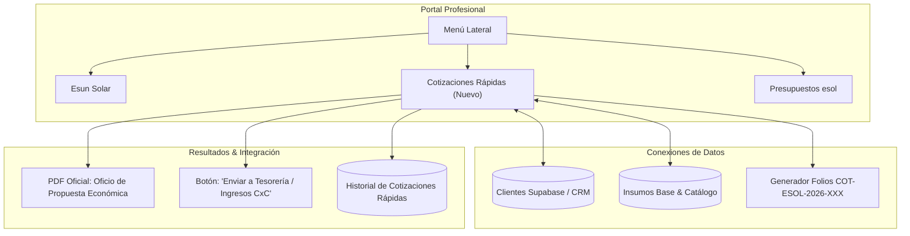

# PLAN DE EJECUCIÓN: COTIZADOR RÁPIDO FORMAL (SERVICIOS PROFESIONALES E INSUMOS)

## 1. Visión y Objetivo
Construir una herramienta ágil pero con tono corporativo formal de propuesta/oficio económico para:
- Contratación de servicios profesionales e ingeniería.
- Visitas técnicas de inspección y levantamiento en sitio.
- Venta o suministro de insumos básicos (tableros, protecciones, inversores, cableado).
- Servicios de mantenimiento preventivo y correctivo.

**Ubicación en la interfaz:**
En la barra lateral de **Portal Profesional**, posicionado exactamente entre **"Esun Solar"** y **"Presupuestos esol"**.
Identificador de pestaña: `cotizador_express` (nombre en menú: **"Cotizaciones Rápidas"**).

---

## 2. Diagrama de Conexión en el Ecosistema

---

## 3. Especificaciones Funcionales del Módulo

### A. Datos del Oficio / Propuesta Económica
1. **Estados del Documento y Trazabilidad**:
   - **Borrador (`borrador`)**: Para guardar avances, presupuestos preliminares o revisiones internas sin generar folio definitivo ni afectar Tesorería.
   - **Emitido (`emitido`)**: Propuesta formal terminada con folio definitivo asignado (`COT-ESOL-2026-XXX`), lista para compartir y generar enlace a Google Drive.
   - **Aceptada / Cobrada (`aprobada` / `cobrada`)**: Cuando el cliente da visto bueno, para generar cuenta por cobrar automática en Tesorería.

2. **Almacenamiento y Respaldo en Google Drive**:
   - Cada cotización emitida puede generar su PDF y subirse automáticamente a la carpeta del cliente en **Google Drive** (usando el webhook configurado en `esol_make_webhook_url` o Apps Script de la plataforma).
   - Enlace directo a Drive (`drive_url`) visible y clickeable en el listado para consulta inmediata.
   - Guardado ordenado por carpetas según el cliente (`COTIZACIONES / [Nombre del Cliente] / COT-ESOL-2026-XXX.pdf`).

3. **Encabezado Institucional**:
   - Folio automático correlativo: `COT-ESOL-2026-XXX`.
   - Fecha de emisión y lugar (`Tepic, Nayarit` por defecto, editable).
   - Vigencia de la cotización (ej. 15 días naturales).

4. **Cliente / Destinatario**:
   - Selector reactivo con autocompletado desde la tabla `clientes` de Supabase.
   - Posibilidad de escribir un cliente nuevo o prospecto directamente con guardado rápido a la BD de clientes.
   - Datos capturados: Nombre / Razón Social, Atención a, RFC, Domicilio, Teléfono y Correo.

5. **Tipo de Propuesta / Plantillas de Rellenado Rápido (Presets con 1 clic)**:
   - **Preset 1: Visita e Inspección Técnica en Sitio** (Levantamiento fotogramétrico, análisis de cubierta, revisión de acometida y centro de carga).
   - **Preset 2: Servicios Profesionales de Ingeniería y Gestoría** (Memoria de cálculo, diagramas unifilares, trámites UVIE / CFE).
   - **Preset 3: Suministro de Equipamiento e Insumos Eléctricos** (Paneles, inversores, protecciones AC/DC, canalizaciones).
   - **Preset 4: Póliza de Mantenimiento Integral** (Termografía, torque de conexiones, limpieza especializada y pruebas dieléctricas).
   - **Opción Libre**: Partidas personalizadas desde cero.
4. **Tabla Dinámica de Conceptos / Partidas**:
   - Ítem #
   - Descripción clara y técnica del servicio o insumo.
   - Unidad (Servicio, Visita, Lote, PZA, ML, etc.).
   - Cantidad.
   - Precio Unitario ($ MXN).
   - Importe ($ MXN).
   - Subtotal, Descuento opcional, IVA (16%) y Total Neto en moneda nacional (con conversión automática a texto: *SON: XXX PESOS 00/100 M.N.*).
5. **Condiciones Comerciales y Métodos de Pago**:
   - Esquema de anticipo (ej. 50% anticipo, 50% contra entrega).
   - Tiempo estimado de entrega / ejecución (ej. 3 a 5 días hábiles).
   - Cuentas oficiales de transferencia bancaria (BBVA Bancomer Esol Energías).
6. **Remitente y Firma**:
   - Nombre del emisor / Asesor comercial o Representante.
   - Opción para incrustar firma digital oficial.

---

## 4. Conexiones con el Ecosistema

1. **Con Base de Datos de Clientes (`clientes`)**:
   - Lectura directa vía Supabase y creación instantánea si no existe.
2. **Con Tesorería & Finanzas (Ingresos y Cuentas por Cobrar)**:
   - En cada cotización guardada, si el cliente da luz verde, un botón **"Generar Cobro en Tesorería"** crea la entrada en `esol_admin_ingresos` (estatus `pendiente` o `cobrado`) sin recapturas manuales.
3. **Con el Generador de PDF**:
   - Motor HTML a PDF estilizado (formato membretado ejecutivo de ESOL, tipografía limpia, tabla formal de conceptos y firmas de conformidad y autorización).

---

## 5. Fases de Implementación Técnica

### Fase 1: Estructura de Tipos y Servicio
- Crear `src/types/cotizadorExpress.ts` con interfaces (`CotizacionExpress`, `PartidaExpress`, `PlantillaExpress`).
- Crear `src/services/cotizadorExpressService.ts` para persistencia en Supabase / LocalStorage y vinculación con `adminDbService` (Tesorería).

### Fase 2: Componente del Cotizador Rápido
- Crear `src/components/cotizador-express/CotizadorExpressTab.tsx`.
- Incluir:
  - Selector de cliente / Creación rápida.
  - Selector de plantillas predefinidas (Visita técnica, Servicios profesionales, Insumos, Mantenimiento).
  - Editor dinámico de partidas de costos y totales con cálculo en tiempo real.
  - Historial de cotizaciones emitidas con filtros por cliente, folio y estatus (*Borrador, Enviada, Aprobada, Cobrada*).
  - Modal de previsualización e impresión directa en PDF.

### Fase 3: Integración en Portal Profesional
- En [Portal.tsx](file:///C:/Users/mafre/Esolenergias/src/components/Portal.tsx):
  - Agregar pestaña `cotizador_express` en el menú lateral, ubicado exactamente entre **"Esun Solar"** y **"Presupuestos esol"**.
  - Renderizar `CotizadorExpressTab` cuando `activeTab === 'cotizador_express'`.

### Fase 4: Pruebas y Despliegue
- Validación de cálculos matemáticos e IVA.
- Validación de generación de PDF.
- Build de producción (`npm run build`).
- Despliegue a Hostinger vía `powershell -ExecutionPolicy Bypass -File .\ftp_deploy.ps1`.
- Verificación en vivo en `www.esolenergias.com`.
